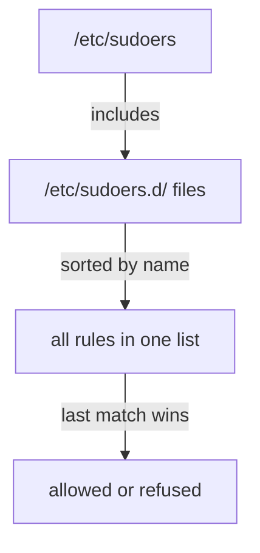

# Aliases And Group Rules

Astronaut, a whole team needs the same orders, and typing the same long command list for each crew member is slow and easy to get wrong. This part shows you how to give a list of commands one short name, how to hand it to a whole group, and how to prove exactly what each crew member may do.

## Name the commands once

A `Cmnd_Alias` is a named list of commands. You write the list once and use the name in any number of rules. Say the `webops` team must check and restart the `ssh` service as `root`, with no door code, and nothing else.

### Write the drop-in

Open the drop-in with `sudo visudo -f /etc/sudoers.d/webops`. Save this as `/etc/sudoers.d/webops`:

<!-- astrona:playground:renew -->

```text
Cmnd_Alias SERVICE_CMDS = /usr/bin/systemctl status ssh, /usr/bin/systemctl restart ssh
%webops ALL=(root) NOPASSWD: SERVICE_CMDS
```

Read the second line from left to right:

- `%webops` is a **group**. The percent sign `%` means "every member of this group". Without it, `webops` would be read as a single user.
- `ALL` means on every host. `(root)` means the commands run as `root`.
- `NOPASSWD:` means no door code is asked for these commands.
- `SERVICE_CMDS` is the alias. `sudo` swaps in the two commands.

Aliases come in a few kinds: `Cmnd_Alias` for commands, `User_Alias` for a named list of users, `Host_Alias` for hosts and `Runas_Alias` for the target user. A `User_Alias` such as `User_Alias OPS = anna, ben` is handy when the people are not in one group.

### Apply it and check it

Apply it. A file made by `visudo` already has the right owner and mode, so one check is enough:

```sh
sudo visudo -c
```

Then check the result:

```sh
sudo -l -U anna
```

Expect something like this (shortened):

```text
User anna may run the following commands on ...:
    (root) NOPASSWD: /usr/bin/systemctl status ssh, /usr/bin/systemctl restart ssh
```

`sudo -l -U anna` lists the rules for another user without becoming that user. It shows the alias already expanded into real commands. Run the same for `ben`: it gives the same answer, because both are in `webops`. Run it for `cleo`: the list still shows nothing.

## Prove the grant is as narrow as you meant

A rule that works is only half of the job. You must also show that the neighbouring commands are refused.

### Run an allowed command and a refused one

Run the allowed command as `anna`. The `-n` option makes `sudo` fail at once instead of asking for a password:

```sh
sudo -u anna sudo -n /usr/bin/systemctl status ssh | head -n 3
sudo -u anna sudo -n /usr/bin/systemctl stop ssh; echo "exit: $?"
```

The first command prints the first lines of the `ssh` service status. The second one is refused, and the last line shows `exit: 1`. `sudo` compares the command word for word. `stop` is not in the alias, so it is not allowed.

The same word-for-word rule means an extra option breaks the match. `systemctl status ssh --no-pager` is a different command from the one in the alias, and `sudo` refuses it.

### Keep a password for a different rule

`NOPASSWD:` belongs to one rule, not to the whole file. A rule without it asks for the user's own password. For example, a second line for `cleo` that lists only `/usr/bin/journalctl -u ssh` and no `NOPASSWD:` would let her read the log, but only after she types her password. That second line is the lab's job to write.

## The order sudo reads the rules

`sudo` reads the main file first, then the drop-ins in sorted name order. When more than one rule matches the same command, the **last** one wins, so a later file can narrow or widen an earlier one.



The picture shows that your drop-in is not read in isolation: a rule in a file that sorts later can change the answer. A leading number such as `10-` or `90-` in the file name makes the order obvious.

## Common pitfalls

> [!WARNING]
> - **Writing `webops` instead of `%webops`.** Without the percent sign, `sudo` looks for a user called `webops` and the group gets nothing.
> - **Extra options in the command.** The rule `systemctl status ssh` does not allow `systemctl status ssh --no-pager`. List every form the user needs.
> - **`NOPASSWD: ALL` as a shortcut.** It grants the whole captain's authority with no door code. Name the commands.
> - **A new group member is still refused.** A running session keeps the groups it started with. Check with `id <user>` and a fresh login.

## Your mission: Group Sudo Rules With Aliases Lab

You can now write a drop-in with an alias, give it to a group, and prove who may run what. The mission asks for a group rule with `NOPASSWD`, a second user with a rule that keeps the password, and a file that passes `visudo -c`.

The mission runs on its own training ship, so first pause your playground. Nothing in it is lost:

```sh
astrona stop sudoers-playground
```

Then start the mission:

```sh
astrona run --git ssh://git@github.com/astrona-io/ATS005.git -c labs/lab-014
```

Open a terminal on the mission ship:

```sh
astrona ssh ats-005-lab-014
```

Read the task in [`question.md`](../../../labs/lab-014/docs/question.md) and solve it on your own first. When you think you are done, send it for grading from your own computer:

```sh
astrona submit -c labs/lab-014
```

When the mission is done, remove it and wake your playground up again:

```sh
astrona destroy ats-005-lab-014
astrona start sudoers-playground
```
